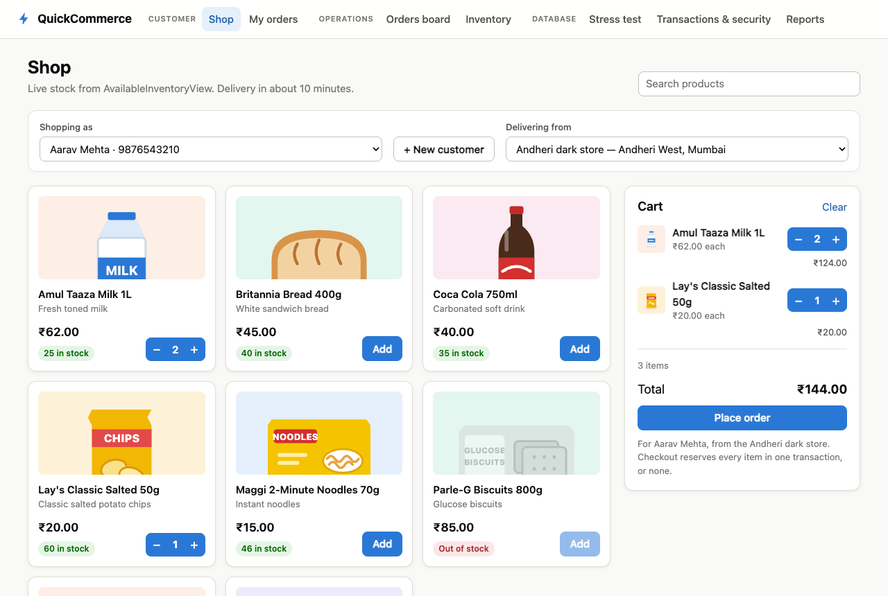
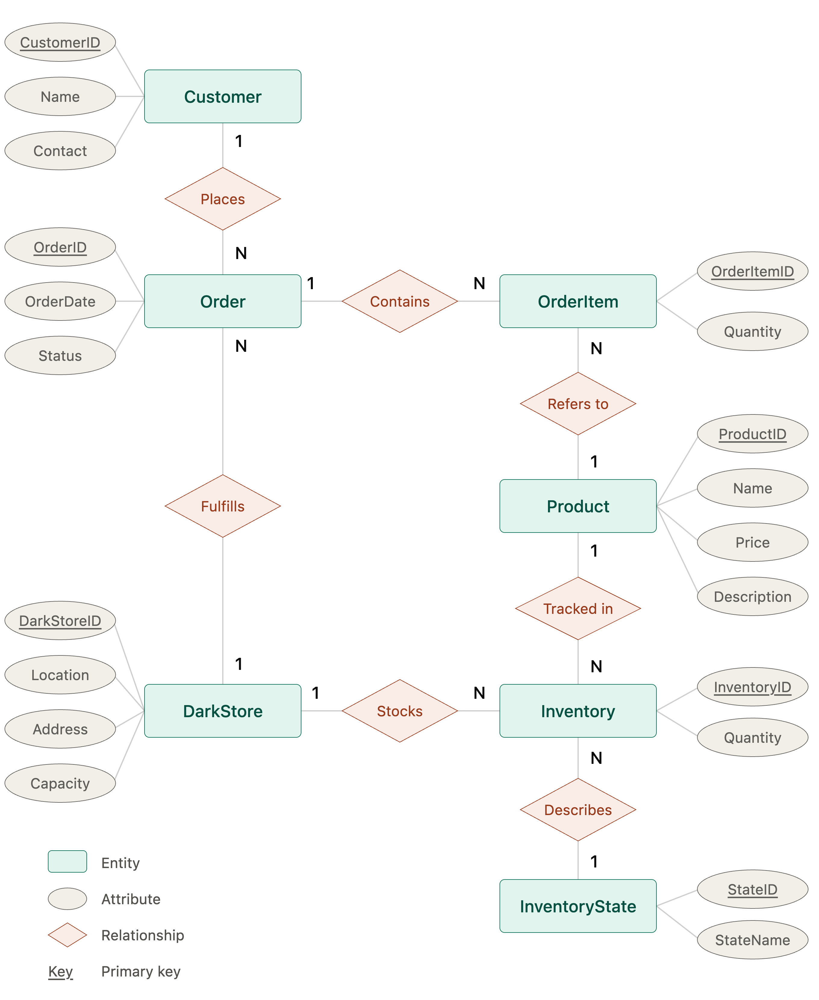
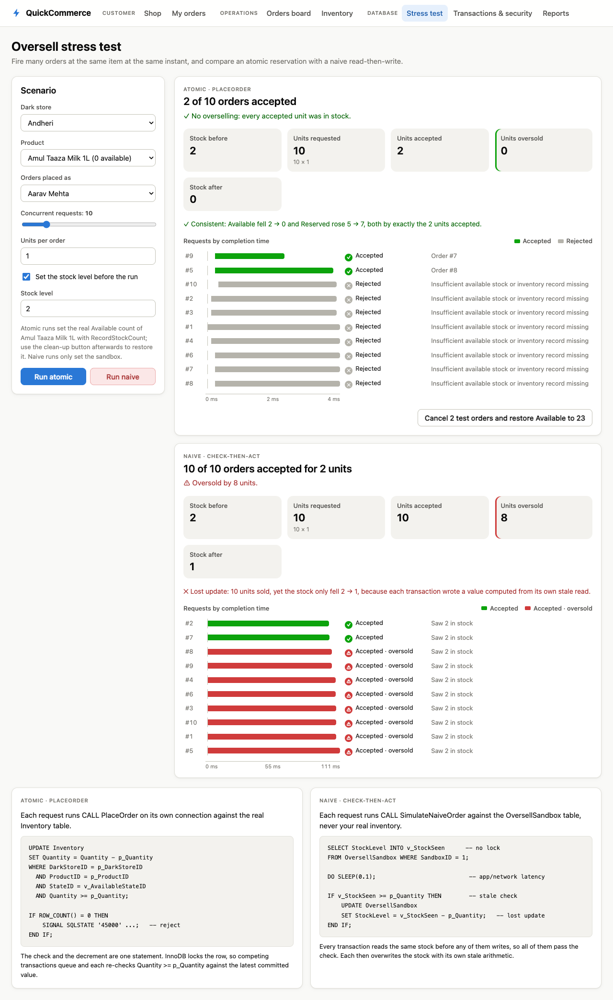
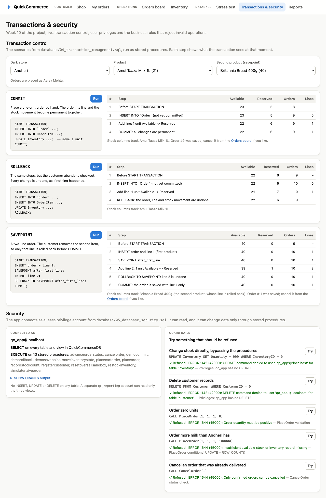
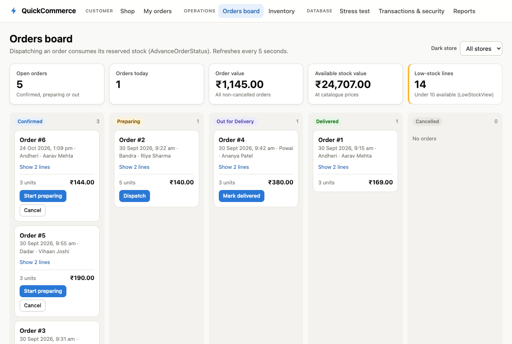
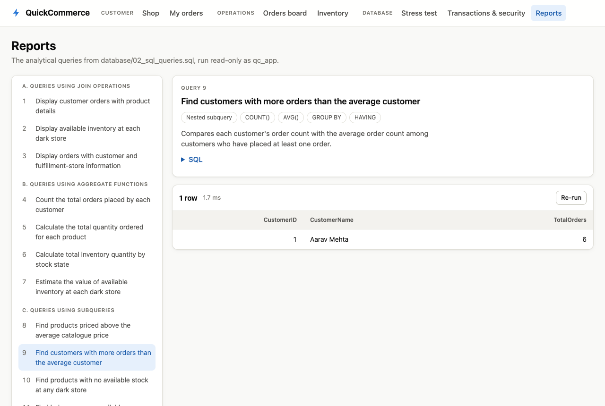

# Real-Time Inventory Consistency in Quick-Commerce Databases

A MySQL database for a quick-commerce (10-minute delivery) platform, built as a four-week DBMS mini project, together with a small web application that uses it. The central requirement is that **stock is never oversold, even when many customers order the last units at the same moment**.



## The problem

Quick-commerce platforms such as Blinkit, Zepto and Instamart deliver from **dark stores**: small, customer-free warehouses of a few thousand square feet, each stocking a few thousand fast-moving products, 1–3 km from their customers. Every product at every store is tracked in four **inventory states**:

| State | Meaning |
|---|---|
| Available | On the shelf and sellable |
| Reserved | Held for orders that are placed but not yet dispatched |
| Damaged | Unsellable (broken, expired) |
| In-Transit | On its way from a warehouse to the store |

The hard part is **concurrency**. Suppose a store has 2 cartons of milk and three customers check out at once. If each transaction first *reads* "2 in stock" and then *writes* a decrement, all three succeed and the store has sold milk it does not have (overselling). The final count may even be wrong (a lost update). The database must make the check and the reservation a single atomic step.

This project solves that with transactions, a conditional `UPDATE … WHERE Quantity >= n` whose affected-row count decides success, stored procedures that own every stock movement, and accounts that cannot touch the tables except through those procedures.

## Project phases

| Week | Task | Deliverable | See it in the app |
|---|---|---|---|
| 7 | Requirement analysis & database design: entities, ER diagram, relational schema, normalisation, tables, sample data | [`docs/er-diagram.png`](docs/er-diagram.png), [`docs/relational-schema.pdf`](docs/relational-schema.pdf), [`database/01_create_db_insert_data.sql`](database/01_create_db_insert_data.sql), [`docs/week7-database-design.pdf`](docs/week7-database-design.pdf) | Shop, Inventory |
| 8 | SQL queries with joins, aggregate functions and subqueries | [`database/02_sql_queries.sql`](database/02_sql_queries.sql), [`docs/week8-sql-queries.pdf`](docs/week8-sql-queries.pdf) | Reports |
| 9 | Stored procedures, triggers and views for business rules | [`database/03_advanced_database_programming.sql`](database/03_advanced_database_programming.sql), [`docs/week9-advanced-database-programming.pdf`](docs/week9-advanced-database-programming.pdf) | Shop, My orders, Stress test |
| 10 | Transaction control, user privileges, testing and demonstration | [`database/04_transaction_management.sql`](database/04_transaction_management.sql), [`database/05_database_security.sql`](database/05_database_security.sql), [`database/07_test_quick_commerce.sql`](database/07_test_quick_commerce.sql), the application in [`app/`](app/) | Transactions & security, Stress test |

[`database/06_application_procedures.sql`](database/06_application_procedures.sql) adds the extra procedures the application needs (multi-item checkout, order progression, stock maintenance). It doesn't change the tables from week 7.

## Database design



| Table | Holds |
|---|---|
| `Customer` | Customers and their contact numbers |
| `DarkStore` | Store location, address and capacity |
| `Product` | Catalogue: name, price, description |
| `InventoryState` | Lookup of the four states above |
| `Inventory` | One row per store × product × state, with a quantity; `UNIQUE (DarkStoreID, ProductID, StateID)` |
| `Order` | Who ordered, from which store, when, and the status |
| `OrderItem` | The products and quantities in each order |

**Why one row per state.** Stock states live in a lookup table instead of four quantity columns. That keeps the schema in third normal form, allows a new state without altering tables, and makes "reserve stock" a precise movement between two rows of the same table.

## Business rules and how they are enforced

| Rule | Mechanism | Where |
|---|---|---|
| Quantities can never be negative | `CHECK (Quantity >= 0)`, plus triggers `ValidateInventoryInsert` / `ValidateInventoryUpdate` | 01, 03 |
| An order line must have a positive quantity | `CHECK (Quantity > 0)`, plus trigger `ValidateOrderItem` | 01, 03 |
| **No overselling under concurrency** | `UPDATE … SET Quantity = Quantity - n WHERE … AND Quantity >= n`, then `ROW_COUNT() = 0` → reject. InnoDB's row lock makes competing orders queue and re-check | `PlaceOrder` (03), `PlaceCartOrder` (06) |
| An order and its reservation succeed or fail together | `START TRANSACTION … COMMIT`, with an exit handler that runs `ROLLBACK` on any error | every procedure |
| Only confirmed orders can be cancelled; cancelling returns stock | `CancelOrder` checks the status under `SELECT … FOR UPDATE` | 03 |
| Applications can't bypass the rules | `qc_app` has `SELECT` and `EXECUTE` only, with no `INSERT`/`UPDATE`/`DELETE`; `qc_reporting` can read the three views only | 05, 06 |

## Running it

### Prerequisites

- MySQL 8.0 or newer
- Node.js 20 or newer (for the app only)

### Option A: SQL scripts only

Run the scripts in [`database/`](database/) in number order with any MySQL client. With the command-line client:

```bash
mysql -u root -p < database/01_create_db_insert_data.sql
mysql -u root -p < database/03_advanced_database_programming.sql
mysql -u root -p < database/05_database_security.sql
mysql -u root -p < database/06_application_procedures.sql
```

- `02_sql_queries.sql` and `04_transaction_management.sql` can then be run at any time.
- Run `07_test_quick_commerce.sql` with `--force`. Its Part C checks errors on purpose, and every check states its expected result.
- `01` creates `QuickCommerceDB` and fails if it already exists. Drop the database first to start again.

### Option B: the application

```bash
cd app
cp .env.example .env        # then set DB_ADMIN_PASSWORD to your MySQL root password
npm install
npm run db:setup            # drops and rebuilds QuickCommerceDB from database/
npm run dev                 # open http://localhost:5173
```

- **Passwords in `.env`:** `#` starts a comment, so wrap any password that contains `#` or spaces in single quotes. `DB_APP_PASSWORD` must satisfy MySQL's password policy: 8+ characters, with upper- and lower-case letters, a digit and a symbol.
- **What `db:setup` runs:** files 01, 03, 05 and 06. It skips their demonstration `SELECT`/`CALL` statements, so rebuilding creates no test orders. It then sets `qc_app`'s password from `.env`.
- **If `qc_app` can't log in over TCP,** set `DB_SOCKET` (for example `/tmp/mysql.sock`) in `.env`.
- **To stop the app,** press Ctrl+C. For a single-port production build, run `npm run build && npm start` and open http://localhost:4000.

## The application

A Node.js (Express) API and a React (Vite) client. The API connects only as `qc_app`, so every change it makes goes through a stored procedure.

| Page | What it shows |
|---|---|
| **Shop** | Pick a customer and a dark store, browse live stock, and check out a multi-item cart. Either every item is reserved or none is. |
| **My orders** | A customer's orders. Confirmed ones can be cancelled. |
| **Orders board** | KPIs and every order by status. Orders are advanced Confirmed → Preparing → Out for Delivery → Delivered; dispatch consumes the reserved stock. |
| **Inventory** | Stock in all four states per store, with restock, mark-damaged, receive-in-transit and stock-count actions. |
| **Stress test** | Up to 50 orders for the same item at the same instant. The atomic `PlaceOrder` never oversells; a deliberately naive read-then-write version (run on a sandbox table) does, and loses updates. |
| **Transactions & security** | The COMMIT, ROLLBACK and SAVEPOINT scenarios from `04`, step by step; the app account's privileges; and five operations that MySQL refuses. |
| **Reports** | Runs the twelve queries from `02_sql_queries.sql`, read directly from that file. |

| | |
|---|---|
|  |  |
|  |  |

## Testing

- **SQL:** `mysql -u root -p --force QuickCommerceDB < database/07_test_quick_commerce.sql`. It checks the views, places and cancels an order, and confirms that seven invalid operations are rejected without changing any stock.
- **Application:** `cd app && npm test` rebuilds the database and runs 17 API integration tests. They cover:
  - atomic checkout and rollback
  - cancellation and dispatch
  - inventory maintenance
  - zero overselling under 10 concurrent orders
  - the COMMIT / ROLLBACK / SAVEPOINT demonstrations
  - every guard rail and every report query
  - the fact that `qc_app` cannot write to tables directly

## Known limitations

These are deliberate simplifications or things a production system would do differently:

- **`OrderItem` stores no unit price.** Order totals use the current `Product.Price`, so a price change also changes the value of past orders. A `UnitPrice` column captured at checkout would fix this.
- **`Order.Status` is free text.** Valid values are enforced by the procedures, not by the schema; a `CHECK` constraint or a lookup table (like `InventoryState`) would be stricter.
- **`Order` is an SQL reserved word,** so it needs backticks everywhere.
- **Some constraints are missing.** `OrderItem` doesn't prevent duplicate lines for the same product. `Customer.Contact` isn't unique. `DarkStore.Capacity` is recorded but not enforced.
- **`LowStockView` includes products a store doesn't carry at all,** because they have zero available units.
- **Reservations don't expire,** and payment and delivery tracking are out of scope.
- **The application has no login.** It is a local demonstration, and anyone who can open it can use the operations pages.

## Repository layout

```
database/   SQL scripts, numbered in run order (01–07)
docs/       ER diagram, relational schema, weekly reports, screenshots
app/        Web application
  server/   Express API, database setup script and tests
  client/   React user interface
```
